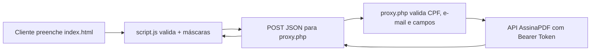

# FMSHOP — Formulário de Cadastro

> Um formulário simples e seguro para iniciar contratos com a FMSHOP via API com AssinaPDF.

<p>
  
</p>


Esse repositório guarda a página oficial de **cadastro / solicitação de contrato da FMSHOP**, operada com segurança pela **AssinaPDF**.

A ideia é bem direta: em vez de papelada, PDFs soltos no WhatsApp ou formulários confusos, o cliente preenche nome, CPF, contato e endereço em uma tela só — e os dados chegam organizados e validados direto na API.

### O que esse projeto entrega
- Formulário em 3 etapas visuais: 1. Dados pessoais → 2. Contato → 3. Endereço
- Máscaras automáticas de CPF `000.000.000-00` e telefone `(00) 00000-0000`
- Validação amigável em português, com foco automático no primeiro campo com erro
- Feedback claro de sucesso / erro, sem recarregar a página
- Consentimento LGPD explícito + link para a Política de Privacidade
- `proxy.php` que esconde o `API_TOKEN` do front-end e repassa com `Authorization: Bearer`
- Validação dupla: no JavaScript (UX) e no PHP (segurança)
- Zero dependências de build. É só HTML + CSS + JS + PHP
- HTTPS forçado via `.htaccess`

### Stack
Estrutura | HTML5
Estilo | CSS puro
Interação | JavaScript vanilla
Backend | PHP 7.4+ com cURL
Integração | API REST AssinaPDF

### Estrutura do projeto

```text
fmshop/
├── index.html                  # Formulário principal
├── styles.css                  # Todo o visual (form + página de política)
├── script.js                   # Máscaras, validação e envio via fetch
├── proxy.php                   # Proxy seguro para a API
├── politica-de-privacidade.html# Política LGPD v1.2.0
├── .env
├── .htaccess                   # Força HTTPS
├── .gitignore                  
  └──images
    ├── image.png                 
    └── fmshop-removebg-preview.png 
```

### Como funciona o envio



**Payload enviado:**
```json
{
  "nomecliente": "João Pedro",
  "cpfcliente": "00000000000",
  "enderecocliente": "Rua das Flores, 123 - Centro",
  "cidade": "Cambé",
  "telefone": "43999999999",
  "email": "joaozinho@exemplo.com",
  "dn": "1990-05-20",
  "empresa_id": "empresa_id"
}
```

### Segurança e LGPD 
Sabemos que estamos lidando com CPF, endereço e dados de contato. Por isso:
- Token da API **nunca aparece no front-end**. Fica só no `.env` do servidor.
- Validação server-side em `proxy.php`: campos obrigatórios, CPF com 11 dígitos, e-mail válido.
- Consentimento LGPD obrigatório via checkbox antes do envio.
- Página dedicada `politica-de-privacidade.html` conforme Lei nº 13.709/2018 (arts. 7º, 16, 18, 46-49).
- HTTPS forçado, `Content-Type: application/json; charset=utf-8` e timeout de 30s no cURL.
- Sem cookies de rastreamento. Só o essencial para a página funcionar.

### Quem mantém

**FMSHOP** — formulário e operação comercial.
**AssinaPDF** — assinatura digital com validade jurídica, segurança e LGPD.
- Site: https://assinapdf.com.br

### Licença
Projeto privado de uso interno FMSHOP / AssinaPDF. Se você recebeu acesso, use com responsabilidade.